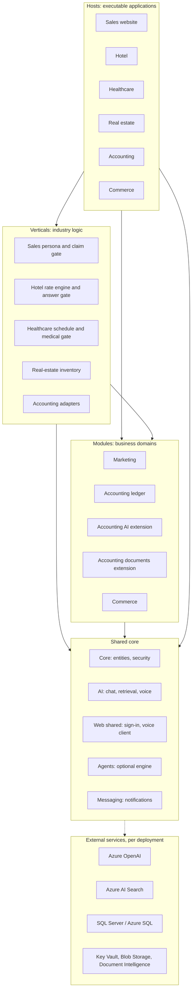
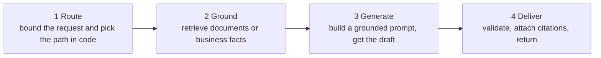

# Enterprise AI Platform: Architecture Overview

**A modular .NET and Azure AI platform in which the model writes language and
code owns every figure.**

This repository contains no code. It describes the architecture of my own
enterprise AI platform: how it is layered, how AI answers are grounded and
checked, how data and access are protected, and what is actually deployed.

The platform is a personal startup initiative. I designed, implemented and
tested it independently, without a registered company or a team, using AI coding
tools under my own review. This overview describes my own work only and contains
no client code, data or confidential material.

A working slice of the hotel path is public, with its tests:
[grounded-hotel-concierge](https://github.com/Babak73314/grounded-hotel-concierge).

*Babak · November 2026*

## Contents

1. [What the platform is](#1-what-the-platform-is)
2. [Technology stack](#2-technology-stack)
3. [Modular architecture](#3-modular-architecture)
4. [AI orchestration and data integrity](#4-ai-orchestration-and-data-integrity)
5. [Persistence and security](#5-persistence-and-security)
6. [Applications](#6-applications)
7. [Delivery status and boundaries](#7-delivery-status-and-boundaries)
8. [Engineering practice](#8-engineering-practice)
9. [What this means for a client project](#9-what-this-means-for-a-client-project)

## 1. What the platform is

A C# platform that combines ASP.NET Core, Blazor, SQL Server and Azure AI. One
shared core powers a commercial sales website, a hotel concierge, a healthcare
information assistant, a real-estate advisor, a commerce storefront and a
finance and accounting application. Each application host composes reusable
business modules and industry-specific logic through dependency injection.

The central design separates AI-generated language from authoritative business
operations:

- Retrieval grounds document answers.
- Code calculates rates, availability, schedules and financial figures.
- Application services enforce authorization and transaction rules.
- Where a model writes text that a customer could act on, a deterministic
  validator checks the draft before it is shown.

Status labels used in this document:

| Label | Meaning |
|---|---|
| **LIVE** | Running publicly in my own Azure environment |
| **DEMO** | Fictional business with synthetic data; never a customer production system |
| **LOCAL** | Engineering-complete, validated locally and in CI; not deployed |
| **OFF BY DEFAULT** | Implemented but switched off in the shipped configuration |

## 2. Technology stack

| Layer | Technologies and implementation |
|---|---|
| Application runtime | C#, .NET 10, ASP.NET Core, dependency injection, typed HttpClient services with resilience handlers where retries are safe, minimal APIs for voice endpoints |
| User interface | Blazor Interactive Server, SignalR circuits, one shared Razor class library, a plain-JavaScript WebRTC voice client, Turkish and English UI |
| Data access | EF Core 10 with SQL Server and Azure SQL; each domain owns its DbContext, schema and migration history; SQLite and in-memory providers in tests |
| AI and retrieval | Azure OpenAI chat and embeddings; Azure AI Search hybrid retrieval (keyword and vector) with semantic reranking; an in-process lexical index for machines without Azure AI Search; Azure Document Intelligence; Azure OpenAI image generation |
| Voice and agents | WebRTC with Azure OpenAI Realtime and server-side turn routing; a multi-provider admin agent (Azure OpenAI, Microsoft Foundry, Anthropic Claude, Google Gemini); Microsoft Agent Framework as a configuration-selected orchestration engine |
| Cloud and configuration | Azure App Service (Linux), Azure SQL Database, Azure Key Vault, Azure Blob Storage, managed identity where supported; PowerShell 7 provisioning scripts that are dry-run by default |
| Engineering automation | xUnit and Node test suites, structural and configuration tests, SQL Server integration gates, GitHub Actions CI with a separate gated SQL Server job, an OIDC-based deployment workflow with version-provenance checks |

## 3. Modular architecture

Four layers separate reusable infrastructure, business domains, industry logic
and executable applications. Only application hosts perform cross-layer
composition.

Solid arrows are project references. The dashed arrow is a runtime service call.

### Dependency rule

The direction of every project reference is fixed and enforced by tests. This is
what keeps the core shared: a module that referenced a vertical would become
that customer's module.

| May reference → | Shared core | Other modules | Verticals | Hosts |
|---|---|---|---|---|
| Shared core | n/a | never | never | never |
| Business module | yes | never | never | never |
| Module extension | yes | its own base only | never | never |
| Vertical adapter | yes | yes | its own vertical | never |
| Host | yes | yes | yes | n/a |

At the end of October 2026 the solution held 40 projects (32 application, 8
test): a five-project shared core, four business modules with their extensions,
seven vertical projects and seven web hosts. Static counts were about 228,000
lines of application C#, 45,000 lines of Razor, and 236,000 lines of test code
declaring roughly 7,000 test methods, plus 124 JavaScript voice-client tests.

### Core engineering decisions

- **Host-owned composition.** Each host selects its shared services, domain
  modules, industry adapters and UI in its own startup code. Business logic
  stays outside the presentation layer, and structural tests fail the build when
  a reference points the wrong way.
- **Independent financial domain.** The accounting module owns the ledger. AI
  assistance and document extraction are separate extensions that consume its
  contracts, so the general ledger runs with no AI in it.
- **Deterministic where a figure matters.** Prices, availability, timetables,
  inventory matches and ledger figures are computed by code, never by a model.
- **Reusable customization.** A new application reuses chat, retrieval, voice,
  administration and data access, and adds its own domain services, knowledge
  content and interface. Sensitive capabilities ship switched off, and a test
  pins the defaults.

## 4. AI orchestration and data integrity

### Grounded text request flow

- **Retrieval and prompts.** Azure AI Search combines keyword and vector
  retrieval with semantic reranking, behind a per-host index allow-list that is
  checked at startup. Retrieved passages are numbered, fenced as untrusted data
  through one fencing routine, and combined with domain instructions and safety
  rules.
- **Deterministic operations.** Hotel dates, rates and availability follow a
  parser, then a calculation engine, then an answer composer. Real-estate
  searches run against the listing inventory in code. Financial reports read
  ledger data through typed services. None of these figures comes from a model.
- **Text validation.** Public sales answers, hotel document answers, healthcare
  answers, marketing drafts and finance copilot narratives each have a
  domain-specific validator. These paths buffer the full draft instead of
  streaming it, allow one controlled retry, and return a defined fallback when
  validation fails.
- **Orchestration engine.** The sales orchestrator runs either as a hand-written
  pipeline or on Microsoft Agent Framework, selected by configuration. Both
  engines share the same prompts and safety rules, so the choice of engine never
  changes what the assistant may claim.

### Voice and multi-model services

- **Live voice.** Browser-to-model WebRTC uses short-lived session credentials
  minted by the host. Turn routing, knowledge-tool selection, language handling
  and transcript-consent checks run on the server. Voice is off by default and
  enabled per deployment. There is no code gate on spoken output, so hosts with
  a strict output boundary, such as healthcare, stay text-only by construction.
- **Internal admin agent.** Transports for Azure OpenAI, Microsoft Foundry,
  Anthropic and Google Gemini support project-specific retrieval, bounded
  document attachments, guarded web research, streaming responses, token and
  cost accounting, and an optional second-model review in which a model never
  reviews its own draft.

## 5. Persistence and security

| Concern | Engineering approach |
|---|---|
| Data ownership | Separate domain contexts and schemas for platform conversations, hotel operations, healthcare data, accounting, marketing and commerce. Each host may open only the database it is configured for. |
| Concurrency | Row-version checks protect edits, and unique constraints support duplicate detection. Financial and commerce operations use explicit transactions and database locking, proved on a real SQL Server engine in CI. |
| Authorization | Staff services enforce access checks behind a shared admin sign-in. Finance resolves company membership on the server and applies company-scoped roles to every service operation; no tool schema can name a company. |
| Request protection | Signed visitor tokens, quotas and rate limits on every anonymous surface; antiforgery controls; HSTS; server-side knowledge-index allow-lists; guarded outbound requests. Model keys never reach a browser. |
| Secrets | Azure Key Vault and managed identity where supported. Publish-output guards keep development settings out of release packages. |
| Audit and observability | Ledger and marketing changes write append-only audit rows in the same transaction. Retrieval outcomes, validation events and model usage feed logs and administrative diagnostics. |

## 6. Applications

### Sales website and administration (LIVE)

A bilingual, knowledge-grounded sales assistant with text and live voice,
conversation history, lead capture and notifications. The public text pipeline
validates commercial claims before returning an answer. Administrative
components provide knowledge management, model selection, document-assisted
research and the admin agent. An AI evaluation lab and a marketing workspace are
implemented and switched off in the public deployment.

### Hotel concierge and operations (DEMO, public Azure deployment)

Document Q&A is combined with a deterministic stay parser and pricing engine.
Staff-managed room rates and availability feed the same calculation services
that the concierge and the request form use. Reservation requests are re-priced
on the server, saved with consent and processed through a staff queue. They are
requests, never bookings. The demo runs on Azure App Service, a dedicated Azure
SQL Database and an Azure AI Search index, with live voice enabled. No
property-management system is connected.

### Healthcare information and scheduling (DEMO, local)

A text-only assistant combines local document retrieval with a staff-maintained
service timetable. Code handles crisis and emergency inputs before any model
call, and medical-claim checks validate generated answers for diagnosis, dosing,
result interpretation and false reassurance. Appointment-request services
revalidate the selected time and the consent. The demo is non-clinical and keeps
no real patient data.

### Real-estate advisor (DEMO, local)

A bilingual property advisor and listing administration for a fictional agency.
A deterministic extractor turns a sentence such as "a one-bedroom rental between
70 and 90 square metres" into structured search criteria. The inventory service
runs the search in code, and the assistant, by text or live voice, answers only
from the matching listings and cites their reference codes.

### Commerce storefront (DEMO, local)

A bilingual storefront with guest and member shopping, persistent carts, a
simulated checkout with idempotent and atomic stock handling, a protected admin,
and a shopping assistant whose drafts are validated before display. The
assistant cannot place an order or change a cart unasked. Every AI capability
ships switched off, and nothing is paid or shipped.

### Accounting and financial intelligence (LOCAL)

A reusable multi-company ledger manages accounts, fiscal periods, opening
balances and a journal lifecycle of Draft, Approved, Posted and Reversed.
Reports share one deterministic calculation engine. Cost centres, open items and
ageing, cash and bank records, budgets and deterministic cash-flow forecasts
extend the domain across about thirty Blazor screens.

The finance copilot calls typed, read-only reporting tools and checks every
figure in its narrative against their results. A narrative whose figures cannot
be traced to a tool result is withheld. Journal creation passes through drafts
that a person confirms. Approval and posting belong to application services, on
screens the AI cannot reach. Every import path (CSV and XLSX, SQL and HTTP
connectors, invoice extraction with Azure Document Intelligence) ends in a
reviewable draft.

### Marketing and social-media workspace (OFF BY DEFAULT)

Campaigns, briefs, content variants, evidence references and an approval
workflow with an append-only audit trail. Model drafts pass a deterministic,
brand-specific claim gate before they are stored. A second-model review is shown
as advice and never decides. AI image drafts are inspected and approved by a
person. Nothing connects to a social network, and nothing is published or
scheduled automatically.

### Extending the architecture

| Step | What is added |
|---|---|
| Domain | Industry-specific services, rules and data ownership |
| Composition | The shared services, modules and adapters selected in a host |
| Experience | Pages, admin workflows, branding and knowledge content |
| Validation | Tests for authorization, data integrity, AI paths and packaging |

Customer-specific integration logic belongs behind scoped adapters. The
accounting integration layer uses CSV and XLSX readers and SQL and HTTP
connector contracts to turn external entries into reviewable drafts. No external
system ships connected. Adding the healthcare vertical changed no existing
project beyond the solution file, four host-isolation tests and documentation.

## 7. Delivery status and boundaries

| Capability | State | What that means |
|---|---|---|
| Commercial site (assistant, admin agent, lead pipeline) | LIVE | Published to my own Azure environment; deployment workflow with OIDC login and provenance checks |
| Hotel demo | DEMO, public Azure deployment | Fictional property, synthetic data; live voice on; no property-management system; no customer |
| Healthcare demo | DEMO, local, text-only | One live model red-flag evaluation (September 2026); not a clinical system; no hospital system |
| Real-estate demo | DEMO, local | Demo inventory; text and voice assistant; no listing-service integration |
| Commerce demo | DEMO, local | Simulated checkout; AI features off; nothing deployed |
| Finance and accounting | LOCAL | Engineering-complete; gated SQL Server suites run in CI; one controlled live copilot smoke run; never deployed; no statutory certification |
| Marketing module | OFF BY DEFAULT | Every switch off; one authorized live image-generation call |
| Live voice (shared) | OFF BY DEFAULT | Enabled per deployment (on in the hotel demo); no deterministic gate on spoken output, so the healthcare host stays text-only |
| Integrations (hotel, hospital, ERP, bank feeds) | Contracts only | Preview-then-draft paths exist; nothing is connected |
| Scale-out | Single instance | Quotas and caps are per process, sized for single-instance App Services |

**What is not claimed.** No customer deployment, penetration test, SLA,
user-acceptance test, statutory accounting certification or healthcare
certification exists, and none is claimed here. Test counts are static
declarations, not a record of executed runs.

## 8. Engineering practice

- **Evidence vocabulary.** Every change is recorded as PASS, FAIL, NOT RUN or
  BLOCKED. "Engineering complete" is kept apart from integration, CI,
  deployment, runtime validation, user acceptance and go-live. A feature is
  described at the level it was actually validated.
- **AI-assisted development under review.** I code and debug hands-on and use AI
  coding tools for implementation support, automated testing and independent
  review. I set the scope and the acceptance criteria, review every change and
  its test evidence, and keep responsibility for the architecture, the code
  quality and every merge and deployment decision.
- **Continuous integration.** GitHub Actions builds the solution and runs the C#
  and JavaScript suites on every pull request. The SQL Server suites (for
  example 165 gated finance tests and 141 commerce engine tests) run in separate
  jobs against a throwaway engine, so no engine-dependent test can be silently
  skipped. Paid live-model evaluations are opt-in and recorded separately.
- **Documentation discipline.** Each product has a guide and a dated status
  register. Architecture decisions, review findings and what was deliberately
  not run are written down with the revision they refer to.

## 9. What this means for a client project

- **Reusable foundation.** Grounded chat, live voice, administration, quotas,
  fencing and database infrastructure exist once and are composed per
  application. A new assistant or copilot starts from tested parts.
- **Trustworthy figures.** The pattern of code-owned calculations, typed tools,
  claim validation and human approvals transfers directly to finance,
  operations, pricing and any domain where a model's number could be acted on.
- **Governed AI.** Server-side allow-lists, untrusted-content fencing, output
  gates, audit trails and switched-off defaults are platform features, not
  per-project promises.
- **Honest scope.** Branding, tone, safety rules, knowledge content, switches
  and cloud resources are configuration. A new vertical, host or adapter is
  bounded code. Connecting a real hotel, ERP, hospital or banking system is
  scoped integration work with its own testing and compliance obligations. The
  platform makes the first part cheap and the second part bounded; it does not
  make it zero.

---

Copyright (c) 2026 Babak. All rights reserved. Prepared independently as part of
a personal startup portfolio. Not a client deliverable; no client data,
confidential material or third-party intellectual property is included.
